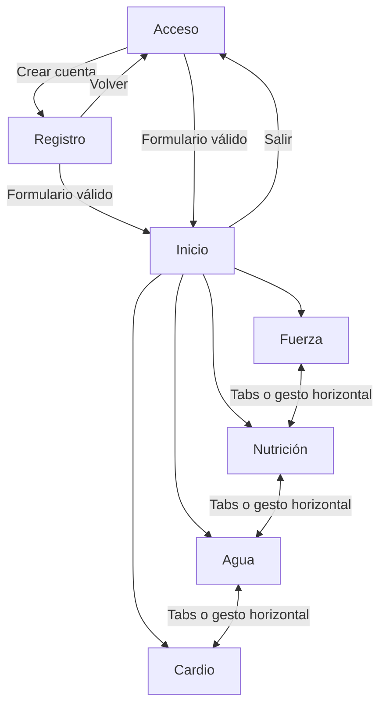

# PlanCerca: definición del producto y mapa de pantallas

**Documento de trabajo para Entregable 1, secciones B1 y B2**  
**Asignatura:** Programación Móvil (DS4AC1-313) · Tercer semestre  
**Período:** 2026-II  
**Institución:** IST Yavirac  
**Estado:** borrador inferido del prototipo; validar con el equipo antes de exportar y entregar.

## 1. Problema

Personas que empiezan a crear hábitos de actividad física pueden tener sus rutinas, hidratación y recomendaciones básicas dispersas. El prototipo reúne esos módulos en una sola interfaz para que sea más sencillo consultar el plan del día.

Esta formulación se infiere de las pantallas actuales. El equipo debe confirmar que corresponde al problema que investigó y añadir evidencia de entrevistas u observación si la tiene.

## 2. Usuario objetivo

Persona adulta que realiza actividad física recreativa y busca una guía sencilla para consultar y organizar sus hábitos de entrenamiento, alimentación e hidratación. Es una hipótesis inicial, no un resultado validado de investigación.

## 3. Propuesta y alcance del MVP

PlanCerca presenta un panel de bienestar con secciones cortas y accesibles desde una barra inferior o mediante gestos horizontales.

Incluido en el prototipo:

- Acceso y registro con validación local de nombre, formato de correo y contraseña de al menos ocho caracteres.
- Panel de inicio con una lista de módulos locales.
- Pantallas independientes para Fuerza, Nutrición, Hidratación y Cardio.
- CRUD local (crear, leer, editar y eliminar registros) en cada pantalla de módulo.
- Navegación entre pantallas mediante tabs, tarjetas y deslizamiento.
- Cierre de sesión que regresa al formulario de acceso.

Fuera del alcance actual:

- Autenticación real, perfiles y almacenamiento persistente.
- Personalización clínica o recomendaciones médicas/nutricionales.
- Sincronización, recordatorios del sistema o conexión con servicios externos.

Los datos son demostrativos y se mantienen en memoria solo durante la sesión. El formulario simula el acceso al panel después de validar; no crea ni autentica una cuenta.

## 4. Mapa de pantallas



Las secciones del panel son vistas internas de `HomeScreen`; Acceso, Registro e Inicio son pantallas del navegador React Navigation.

## 5. Bocetos de baja fidelidad

### Acceso

```text
+----------------------------------+
|                                  |
|            PlanCerca             |
|      Tu plan de bienestar        |
|                                  |
|  [ Correo electrónico         ]  |
|  [ Contraseña                 ]  |
|  [       Entrar               ]  |
|                                  |
|       ¿No tienes cuenta?         |
|          Regístrate              |
+----------------------------------+
```

### Registro

```text
+----------------------------------+
|         Únete a PlanCerca        |
|                                  |
|  [ Nombre completo           ]  |
|  [ Correo electrónico         ]  |
|  [ Contraseña                 ]  |
|  [      Crear cuenta          ]  |
|                                  |
|         Inicia sesión            |
+----------------------------------+
```

### Inicio y detalle de sección

```text
+----------------------------------+
| Hola, deportista          [Salir]|
| Tus módulos                      |
| [ Fuerza             Intermedio ]|
| [ Nutrición           1,850 kcal]|
| [ Hidratación           2.5 L   ]|
| [ Cardio                 20 min ]|
|                                  |
| Inicio  Fuerza  Nutrición Agua  |
+----------------------------------+
```

```text
+----------------------------------+
| Hidratación                     |
| Meta de Consumo de Agua         |
| Objetivo / nivel: 2.5 Litros    |
| En esta sección                 |
| • Al despertar: 1 vaso          |
| • Bebe con regularidad           |
|                                  |
| Inicio  Fuerza  Nutrición Agua  |
+----------------------------------+
```

## 6. Criterios de aceptación del MVP

- El usuario puede ir de Acceso a Registro y regresar.
- Un formulario válido muestra Inicio; uno inválido presenta un mensaje de corrección.
- Inicio presenta cuatro elementos desde una fuente local usando `FlatList`.
- Cada categoría abre una pantalla propia con operaciones para crear, leer, editar y eliminar registros.
- Tabs, tarjetas y gestos cambian entre secciones sin interferir con el scroll vertical; los registros se mantienen al cambiar de tab.
- Al reiniciar la app, los registros vuelven a los datos iniciales porque no existe persistencia.
- Salir regresa a Acceso.
- El flujo completo se demuestra en un celular físico antes de marcarlo como verificado.

## 7. Validaciones pendientes del equipo

- Confirmar problema, usuario objetivo, nombre y funciones reales del MVP.
- Completar nombres de integrantes, roles, fecha y evidencia de investigación.
- Reemplazar estos bocetos por los acordados con el equipo si difieren de la interfaz implementada.
- Exportar este documento al formato PDF requerido y revisarlo antes de entregar.
